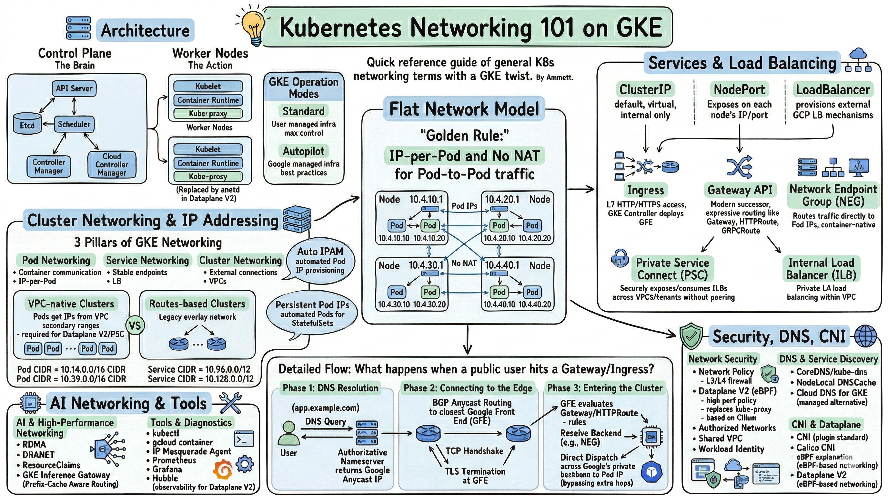

<h1 align="center"> Kubernetes Networking 101 on GKE </h1>

It's easy to get lost in a conversation around Kubernetes networking. Well, this reference sheet can help with that. **💡**

This is a quick 101-level reference guide of general Kubernetes networking terms with an added Google Kubernetes Engine (GKE) twist.

*By [Ammett](https://www.linkedin.com/in/ammett/)*

 

## Download current version:
All active links are in the PDF document.

 

## Feedback
Connect with me on 

---
# Contents
:link: - Link icon

* [🧱 Networking Fundamentals](#-networking-fundamentals)
* [🏗️ Standard Cluster Architecture](#️-standard-cluster-architecture)
* [🌐 Cluster Networking Model & IP Addressing](#-cluster-networking-model--ip-addressing)
* [🔌 Services & Load Balancing](#-services--load-balancing)
* [🛡️ Network Security & Policies](#️-network-security--policies)
* [🗺️ DNS & Service Discovery](#️-dns--service-discovery)
* [📦 CNI & Dataplane](#-cni--dataplane)
* [🤔 What happens when a public user hits a Gateway (or Ingress)?](#-what-happens-when-a-public-user-hits-a-gateway-or-ingress)
* [🤖 AI & High-Performance Networking](#-ai--high-performance-networking)
* [🛠️ Tools & Diagnostics](#️-tools--diagnostics)
* [📖 GKE Must Read Networking Documentation](#-gke-must-read-networking-documentation)

### 🧱 Networking Fundamentals

Before diving into Kubernetes, it helps to understand the core concepts that make all network communication possible:

* **[IPv4](https://www.cisco.com/c/en/us/support/docs/ip/routing-information-protocol-rip/13788-3.html#anc5)**: The standard 32-bit numeric addressing system (e.g., `192.168.1.100`). Due to address exhaustion, it relies heavily on NAT.
* **[IPv6](https://datatracker.ietf.org/doc/html/rfc4291#section-2)**: The modern 128-bit hexadecimal addressing system designed to solve IPv4 exhaustion. GKE supports dual-stack (IPv4/IPv6) clusters.

* **[DHCP (Dynamic Host Configuration Protocol)](https://datatracker.ietf.org/doc/html/rfc2131#section-2.2)**: A network management protocol used to automatically assign IP addresses to devices on a network so they can communicate. [:link:](https://wikipedia.org/wiki/Dynamic_Host_Configuration_Protocol) 

* **[Internal IP (Private IP) RFC1918](https://cloud.google.com/compute/docs/ip-addresses#networkaddresses)**: An address (e.g., `10.0.0.5`) used exclusively for communication within a closed, private network.  [:link:](https://datatracker.ietf.org/doc/html/rfc1918) 
* **[External IP (Public IP)](https://cloud.google.com/compute/docs/ip-addresses#externaladdresses)**: An address (e.g., `34.120.x.x`) that is globally unique and routable across the public internet.

* **[TCP (Transmission Control Protocol)](https://datatracker.ietf.org/doc/html/rfc793#section-1.1)**: A connection-oriented protocol that guarantees the reliable, ordered delivery of data.
* **[UDP (User Datagram Protocol)](https://datatracker.ietf.org/doc/html/rfc8304#section-3.1)**: A connectionless protocol that prioritizes speed over reliability.

* **[DNS (Domain Name System)](https://cloud.google.com/dns/docs/overview)**: Resolves human-readable domain names to IP addresses.
* **[NAT (Network Address Translation)](https://cloud.google.com/nat/docs/overview)**: Maps one IP address space to another, allowing private networks to share a public IP. *(Note: K8s avoids NAT for Pod-to-Pod traffic).*

### 🏗️ Standard Cluster Architecture

* **[Control Plane (The Brain)](https://kubernetes.io/docs/concepts/architecture/)**: Components that manage the cluster's desired state.
* **[API Server](https://kubernetes.io/docs/concepts/architecture/#kube-apiserver)**: The front door for all REST commands. All components communicate exclusively through it.
* **[Etcd](https://kubernetes.io/docs/concepts/overview/components/#etcd)**: The reliable "source of truth" backing store for all cluster data.
* **[Scheduler](https://kubernetes.io/docs/concepts/scheduling-eviction/kube-scheduler/)**: Assigns newly created Pods to available Nodes.
* **[Controller Manager](https://kubernetes.io/docs/concepts/architecture/#kube-controller-manager)**: Runs core background loops to reconcile actual state with desired state.
* **[Cloud Controller Manager](https://kubernetes.io/docs/concepts/architecture/cloud-controller/)**: Links the cluster to the cloud provider's API.

***

* **[Worker Node (The Action)](https://kubernetes.io/docs/concepts/architecture/nodes/)**: The machines running your containers.
* **[Kubelet](https://kubernetes.io/docs/concepts/architecture/#kubelet)**: The node agent that registers the node and ensures Pod containers are running and healthy.
* **[Container Runtime](https://kubernetes.io/docs/setup/production-environment/container-runtimes/)**: The software running the containers (e.g., containerd).
* **[Kube-proxy](https://kubernetes.io/docs/concepts/architecture/#kube-proxy)**: The node's network agent. *(Note: Replaced by `anetd` in Dataplane V2 to directly program eBPF).*

#### 🚀 GKE Operation Modes

* **[GKE Standard](https://docs.cloud.google.com/kubernetes-engine/docs/resources/autopilot-standard-feature-comparison)**: You manage the cluster's underlying infrastructure, including node configuration and scaling. Offers maximum control over custom networking setups.
* **[GKE Autopilot](https://docs.cloud.google.com/kubernetes-engine/docs/concepts/autopilot-overview)**: Google manages the nodes and infrastructure entirely; you just deploy Pods and pay for the resources they use. Enforces networking best practices by default.

* **[ComputeClass Concept](https://docs.cloud.google.com/kubernetes-engine/docs/concepts/about-compute-classes)**: Allows you to define node profiles with specific hardware and networking capabilities directly within your cluster configuration.

> **[The "Flat Network" Model](https://kubernetes.io/docs/concepts/cluster-administration/networking/)** ⬇️ ⬇️
> * **Golden Rule**: Every Pod gets its own IP address.
> * **No NAT**: Pods on one node communicate with Pods on another node without NAT.
> * **IP-per-Pod**: Creates a clean address space where Pods treat each other as distinct physical hosts.

### 🌐 Cluster Networking Model & IP Addressing

**[The 3 Pillars of GKE Networking](https://docs.cloud.google.com/kubernetes-engine/docs/learn/learn-gke-net-fundamentals)**
1. **[Pod Networking](https://docs.cloud.google.com/kubernetes-engine/docs/learn/learn-gke-net-architecture#pod-networking)**: Container communication (IP-per-Pod).
2. **[Service Networking](https://docs.cloud.google.com/kubernetes-engine/docs/concepts/service-networking)**: Stable endpoints (Load Balancing) to expose apps.
3. **[Cluster Networking](https://docs.cloud.google.com/kubernetes-engine/docs/learn/learn-gke-net-architecture#cluster-networking)**: External connections (VPCs, Internet, On-Prem).

* **[IP Masquerade Agent](https://docs.cloud.google.com/kubernetes-engine/docs/concepts/ip-masquerade-agent)**: Controls SNAT for outbound Pod traffic via `nonMasqueradeCIDRs`.
* **[VPC-native Cluster](https://docs.cloud.google.com/kubernetes-engine/docs/concepts/alias-ips)**: Default GKE mode. Pods get IPs directly from the VPC's secondary ranges (Alias IPs). Required for Dataplane V2 and PSC.
* **[Routes-based Cluster](https://docs.cloud.google.com/kubernetes-engine/docs/how-to/routes-based-cluster)**: (Legacy) Pods use an overlay network with routes programmed in the VPC. Prone to scaling limits.
* **[Auto IPAM](https://docs.cloud.google.com/kubernetes-engine/docs/how-to/enable-auto-ipam#overview)**: Automates Pod IP provisioning by dynamically assigning smaller chunks (`/24`s) to nodes, sharply reducing IP exhaustion.
* **[Multi-Subnet Clusters](https://docs.cloud.google.com/kubernetes-engine/docs/how-to/multi-subnet-cluster)**: Allows node pools to span multiple subnets in the same region, bypassing single-subnet limits.
* **[Pod CIDR](https://docs.cloud.google.com/kubernetes-engine/docs/concepts/alias-ips#pod_ip_addresses)**: IP range assigned to Pods (a VPC secondary range in VPC-native clusters).
* **[Service CIDR](https://docs.cloud.google.com/kubernetes-engine/docs/concepts/alias-ips#cluster_sizing)**: A virtual IP range used purely for software-defined ClusterIP services.
* **[Persistent Pod IPs](https://docs.cloud.google.com/kubernetes-engine/docs/concepts/about-persistent-ip-addresses-for-gke-pods)**: Allows `StatefulSet` pods to retain their exact IP across restarts. Uses config "Reaction Modes" to safely move IPs based on health.

### 🔌 Services & Load Balancing

* **[ClusterIP](https://kubernetes.io/docs/concepts/services-networking/service/#type-clusterip)**: Default Service type. Exposes the Service on an internal IP, reachable only within the cluster.
* **[NodePort](https://kubernetes.io/docs/concepts/services-networking/service/#type-nodeport)**: Exposes the Service on each Node's IP at a static port (default 30000-32767).
* **[LoadBalancer](https://kubernetes.io/docs/concepts/services-networking/service/#loadbalancer)**: Provisions an external IP (via Google Cloud Load Balancer) to expose the Service to the internet.
* **[External Passthrough (L4)](https://docs.cloud.google.com/kubernetes-engine/docs/how-to/exposing-apps#creating_a_service_of_type_loadbalancer)**: Routes traffic directly to backend Pods via a public IP, bypassing HTTP/S proxies.
* **[Internal Load Balancer (ILB)](https://docs.cloud.google.com/kubernetes-engine/docs/how-to/internal-load-balancing)**: Private L4 load balancing within the VPC. 
* **[Private Service Connect (PSC)](https://docs.cloud.google.com/kubernetes-engine/docs/concepts/private-service-connect)**: The modern standard for securely exposing/consuming ILBs across VPCs or tenants without VPC Peering or public IPs.
* **[Ingress](https://docs.cloud.google.com/kubernetes-engine/docs/concepts/ingress)**: Manages external HTTP/HTTPS access. The GKE Controller auto-deploys a Google Cloud Global Load Balancer.
* **[Gateway API](https://docs.cloud.google.com/kubernetes-engine/docs/concepts/gateway-api)**: The modern successor to Ingress, offering expressive routing (Gateway, HTTPRoute).
* **[GRPCRoute](https://docs.cloud.google.com/service-mesh/docs/gateway/overview)**: Protocol-aware routing that matches by gRPC service/method names.
* **[Network Endpoint Group (NEG)](https://docs.cloud.google.com/kubernetes-engine/docs/how-to/standalone-neg)**: Sends load balancer traffic *directly* to Pod IPs (Container-native load balancing).
* **[Headless Service](https://kubernetes.io/docs/concepts/services-networking/service/#headless-services)**: A Service (`ClusterIP: None`) that returns backing Pod IPs via DNS instead of a single VIP.

### 🛡️ Network Security & Policies

* **[Network Policy](https://kubernetes.io/docs/concepts/services-networking/network-policies/)**: The K8s firewall. Controls L3/L4 traffic. (Default: all Pod-to-Pod traffic is allowed).
* **[Dataplane V2 (eBPF)](https://docs.cloud.google.com/kubernetes-engine/docs/concepts/dataplane-v2)**: GKE's high-performance, in-kernel network policy implementation based on Cilium.
* **[Authorized Networks](https://docs.cloud.google.com/kubernetes-engine/docs/how-to/authorized-networks)**: Restricts which external IP ranges can access the K8s API server.
* **[Shared VPC](https://docs.cloud.google.com/kubernetes-engine/docs/how-to/cluster-shared-vpc)**: GKE cluster runs in a "Service Project" but uses networking centrally managed in a "Host Project".
* **[Workload Identity](https://docs.cloud.google.com/kubernetes-engine/docs/concepts/workload-identity)**: Maps a K8s ServiceAccount to a Google IAM Service Account (GSA) for secure GCP API access.
* **[Private Cluster / Isolation](https://docs.cloud.google.com/kubernetes-engine/docs/concepts/network-isolation)**: Nodes have only private IPs and are isolated from the public internet.
* **[Tags](https://docs.cloud.google.com/kubernetes-engine/docs/how-to/tags-firewall-policies#about-tags)**: Secures GKE node pools by automatically attaching IAM-controlled firewall tags to your underlying VM nodes.

### 🗺️ DNS & Service Discovery

* **[kube-dns / CoreDNS](https://kubernetes.io/docs/tasks/administer-cluster/dns-custom-nameservers/#introduction)**: Built-in DNS. Resolves names (e.g., `my-service.my-ns.svc.cluster.local`) to ClusterIPs.
* **[NodeLocal DNSCache](https://docs.cloud.google.com/kubernetes-engine/docs/how-to/nodelocal-dns-cache)**: Runs a cache on each node to reduce latency and CoreDNS load. (Default on Standard GKE).
* **[Cloud DNS for GKE](https://docs.cloud.google.com/kubernetes-engine/docs/how-to/cloud-dns)**: Replaces in-cluster CoreDNS with managed Google Cloud DNS for better scalability.
* **[Service Directory](https://docs.cloud.google.com/service-directory/docs/sd-gke-overview)**: Registers K8s services for discovery by other Google Cloud resources (VMs, Cloud Run).

### 📦 CNI & Dataplane

* **[CNI (Container Network Interface)](https://kubernetes.io/docs/concepts/extend-kubernetes/compute-storage-net/network-plugins/)**: The plugin standard for configuring Pod network interfaces.
* **[Calico CNI](https://docs.projectcalico.org/getting-started/kubernetes/)**: A CNI and routing plugin, utilizing BGP to distribute routes and `iptables` for policy enforcement.
* **[eBPF (Extended Berkeley Packet Filter)](https://ebpf.io/what-is-ebpf/)**: A technology that runs sandboxed programs directly in the Linux kernel without modifying kernel source code, enabling ultra-fast, highly programmable networking, security, and observability.
* **[GKE Dataplane V2](https://docs.cloud.google.com/kubernetes-engine/docs/concepts/dataplane-v2)**: eBPF-based networking. Removes `kube-proxy` bottlenecks and supports up to 65,000 nodes.
* **[SCTP Support](https://docs.cloud.google.com/kubernetes-engine/docs/how-to/deploy-workloads-with-sctp)**: Enables reliable, message-oriented transport on Dataplane V2 clusters.

### 🤔 What happens when a public user hits a Gateway or Ingress?

**Phase 1: DNS Resolution**
* **User Request**: Types `app.example.com`.
* **Local Cache Check**: OS/Browser checks local cache.
* **Recursive & TLD Query**: Resolvers query Root and Top-Level Domain servers.
* **The Answer**: Authoritative Nameserver returns a Google Anycast IP (A Record).

**Phase 2: Connecting to the Edge (The BGP Magic)**
* **BGP Anycast Routing**: Google announces the exact same public IP address from multiple edge Points of Presence (PoPs) worldwide using BGP (Border Gateway Protocol). The internet's backbone routers calculate the shortest autonomous system (AS) path, naturally funneling the user's traffic to the geographically closest Google Front End (GFE).
* **TCP Handshake**: The client and the GFE establish a reliable connection (SYN, SYN-ACK, ACK) before sending any HTTP data.
* **TLS Termination**: The GFE negotiates encryption (TLS handshake) and decrypts the HTTPS request right at the edge.

**Phase 3: Entering the Cluster**
* **Rule Evaluation**: The GFE evaluates the URL maps and routing logic defined by your **Gateway** and **HTTPRoute** (or Ingress) resources to determine the correct destination.
* **Backend Resolution**: The GFE queries the configured Google Cloud Backend. Based on your routing rules, this target can be a **Network Endpoint Group (NEG)** (routing directly to Pod IPs), an **Instance Group** (routing to Node IPs), an **Internal Load Balancer (ILB)**, or a **Cloud Storage (GCS) bucket**.
* **Direct Dispatch**: The packet travels across Google's private backbone directly to the resolved target. For GKE workloads using NEGs, the packet bypasses `kube-proxy` and extra node-to-node routing hops, landing directly on the Pod's network interface.  

### 🤖 AI & High-Performance Networking

* **[RDMA](https://docs.cloud.google.com/vpc/docs/rdma-network-profiles)**: Allows GPUs to exchange data memory-to-memory over the network, bypassing the CPU to drop latency.
* **[Managed DRANET](https://docs.cloud.google.com/kubernetes-engine/docs/how-to/allocate-network-resources-dra)**: A managed GKE network driver utilizing the Kubernetes Dynamic Resource Allocation (DRA) API. It allows Pods running demanding GPU or TPU workloads to dynamically request and claim dedicated, high-performance network interfaces
* **[ResourceClaims](https://docs.cloud.google.com/kubernetes-engine/docs/concepts/about-dynamic-resource-allocation#resourceclaim-vs-resourceclaimtemplate)**: K8s API for requesting specific hardware allocations, capacity, or device partitions.
* **[GKE Inference Gateway](https://docs.cloud.google.com/kubernetes-engine/docs/concepts/about-gke-inference-gateway)**: Gateway API extension for LLMs. Uses Prefix-Cache Aware Routing to send requests to servers with cached prompt contexts.
* **Endpoint Picker**: Monitors KV-cache and pending queues to route traffic to the most efficient model server.
* **Inference Metrics**: Focuses on Time to First Token (latency) and Tokens per Second (throughput).
* **[gVNIC](https://cloud.google.com/compute/docs/networking/using-gvnic)**: Google Virtual NIC, required for high-performance VMs.

### 🛠️ Tools & Diagnostics

* **[kubectl](https://kubernetes.io/docs/reference/kubectl/)**: Primary CLI for the K8s API.
* **[gcloud container](https://cloud.google.com/sdk/gcloud/reference/container)**: CLI for GKE infrastructure.

* **[Prometheus](https://docs.cloud.google.com/stackdriver/docs/managed-prometheus)**: The industry-standard open-source monitoring and alerting toolkit. 
* **[Grafana](https://docs.cloud.google.com/stackdriver/docs/managed-prometheus/query)**: The leading visualization and dashboarding platform. 
* **[Hubble](https://docs.cloud.google.com/kubernetes-engine/docs/how-to/configure-dpv2-observability#configure-cli-binary-distribution)**: Dataplane V2 observability tool for real-time network flow visibility.
* **[Network Policy Logging](https://docs.cloud.google.com/kubernetes-engine/docs/how-to/network-policy-logging)**: Dataplane V2 feature to log allowed/denied connections.
* **[Connectivity Tests](https://cloud.google.com/network-intelligence-center/docs/connectivity-tests/concepts/overview)**: GCP Console tool to simulate packet paths and debug routing issues.

### 📖 GKE must read networking Documentation

* **[GKE Networking Fundamentals](https://docs.cloud.google.com/kubernetes-engine/docs/learn/learn-gke-net-fundamentals)**: The essential conceptual starting point detailing exactly how the abstract open-source Kubernetes IP model maps directly onto Google's global physical VPC architecture.
* **[Understand IP addressing in GKE](https://docs.cloud.google.com/kubernetes-engine/docs/concepts/about-ip-addressing)**: A deep-dive tracking how VPC-native alias IP allocations work across Node, Pod, and Service CIDR ranges—crucial for preventing IP exhaustion before provisioning clusters.
* **[GKE Networking Best Practices](https://docs.cloud.google.com/kubernetes-engine/docs/best-practices/networking)**: The foundational guide for enterprise architects.
* **[GKE Security Hardening Guide](https://docs.cloud.google.com/kubernetes-engine/docs/how-to/hardening-your-cluster)**: Securing traffic flow. Focuses on minimizing control plane exposure, applying least-privilege network firewalls, and isolating workload environments.
* **[Explore the GKE Documentation](https://docs.cloud.google.com/kubernetes-engine/docs/about#network)**: Use this to quickly navigate between various kubernetes documenation tracks.
* **[Troubleshoot GKE networking](https://docs.cloud.google.com/kubernetes-engine/docs/troubleshoot-networking)**: Common troubleshooting tips for GKE networking problems

 

